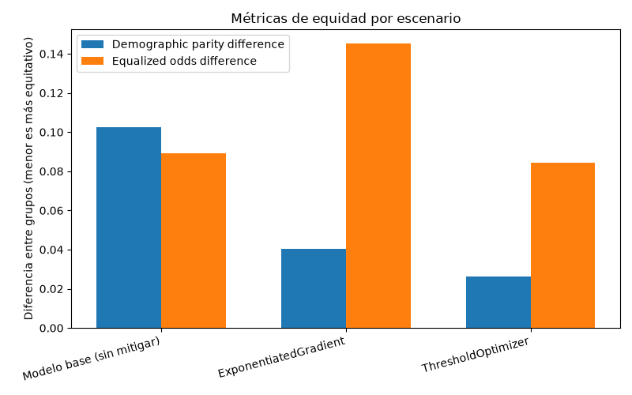
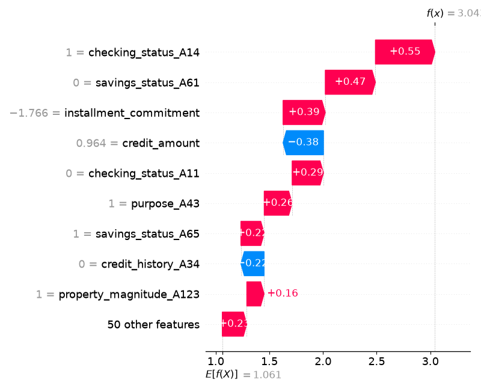
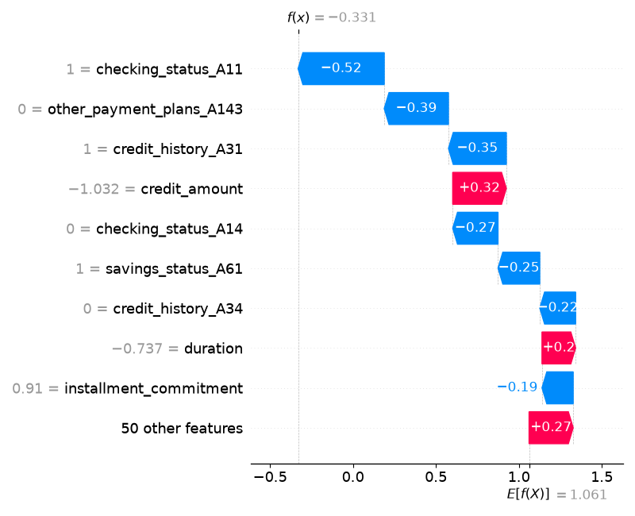
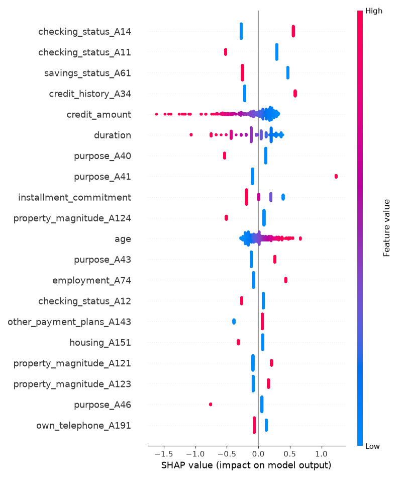

# Evidencias — Auditoría de equidad, mitigación y explicabilidad

_Generado automáticamente el 2026-10-14 13:47._

## Configuración de la corrida

- **Dataset:** data/german_credit.csv
- **Columna objetivo:** `class` (clase positiva: `good`)
- **Atributo sensible:** `sex`
- **Método de mitigación:** `ambos`
- **Restricción de equidad:** `demographic_parity`

## Auditoría de equidad — modelo base (pre-mitigación)

- **Exactitud global:** 0.740
- **Demographic parity difference:** 0.102
- **Equalized odds difference:** 0.089
- **equalized_odds_ratio:** 0.836

### Métricas por grupo

| Grupo | Exactitud | Tasa de selección |
|---|---|---|
| female | 0.708 | 0.677 |
| male | 0.755 | 0.779 |

> **Interpretación (consigna 3):** el patrón es consistente con el caso Amazon. El modelo base selecciona como “good” al 77,9% de los varones frente a solo el 67,7% de las mujeres (brecha de 10,2 pp, DPD=0,102), y acierta menos en mujeres (0,708 vs 0,755). Esto replica el mecanismo documentado por Dastin (2018): el modelo aprende la subrepresentación histórica (en el CSV, solo 31% de mujeres y tasa base de “good” 64,8% vs 72,3% en varones) y la amplifica. El origen es predominantemente **sesgo en los datos de entrenamiento** (representatividad y etiquetado histórico), reforzado por el **diseño del modelo** que incluye `sex` como feature y puede usarlo directamente. La EOD=0,089 y EOR=0,836 confirman que la disparidad no es solo de prevalencia sino de tasas de error (TPR/FPR) entre grupos.

## Comparación antes / después de la mitigación

| Escenario | Exactitud | Demographic parity diff. | Equalized odds diff. |
|---|---|---|---|
| Modelo base (sin mitigar) | 0.740 | 0.102 | 0.089 |
| ExponentiatedGradient | 0.717 | 0.040 | 0.145 |
| ThresholdOptimizer | 0.750 | 0.026 | 0.085 |

> **Discusión (consigna 9.c):** ambas técnicas reducen el DPD (de 0,102 a 0,040 con ExponentiatedGradient y a 0,026 con ThresholdOptimizer), por lo que la mitigación es efectiva para paridad demográfica. Sin embargo hay trade-offs claros: (1) ExponentiatedGradient paga costo en exactitud (0,740 → 0,717, -2,3 pp) y **empeora** la EOD (0,089 → 0,145), ejemplo típico de tensión entre métricas: optimizar demographic_parity no garantiza equalized_odds; (2) ThresholdOptimizer es superior en este caso: baja el DPD a casi cero **y** mejora levemente la exactitud (0,750) manteniendo la EOD (0,085), porque no reentrena sino que calibra un umbral por grupo. Limitaciones: ThresholdOptimizer necesita `sex` en inferencia (riesgo legal/operativo), y ninguna técnica corrige la raíz (datos históricos sesgados). La métrica extra `equalized_odds_ratio=0,836` en base (<1,0) confirma la inequidad inicial y sirve para monitorear que la mitigación no la degrade.

## Explicabilidad (SHAP) — modelo base

SHAP se aplica siempre sobre el modelo base, antes de cualquier mitigación: el objetivo es ver qué técnica de auditoría preventiva podría haber detectado el problema antes del despliegue (consigna 4).

### Predicción 0 — el atributo sensible más influyó

- Contribución absoluta de `sex`: 0.170
- Predicción del modelo: 1 · Valor real: 0

### Predicción 1 — el atributo sensible casi no influyó

- Contribución absoluta de `sex`: 0.088
- Predicción del modelo: 0 · Valor real: 1

### Resumen global

> Sí. En la predicción 0 el atributo `sex` aporta 0,170 al log-odds (casi el doble que en la predicción 1, con 0,088), y el waterfall muestra a `sex_female/male` entre los principales drivers del falso positivo. Una auditoría pre-despliegue con SHAP sobre una muestra de validación hubiese revelado que el modelo usa directamente el género, tal como LIME/SHAP o un simple test de permutación lo hubieran hecho en Amazon antes de producción. SHAP global (beeswarm) confirma que `sex` no es residual. Por tanto, SHAP + Fairlearn (DPD/EOD) como gate obligatorio habrían bloqueado el despliegue.
