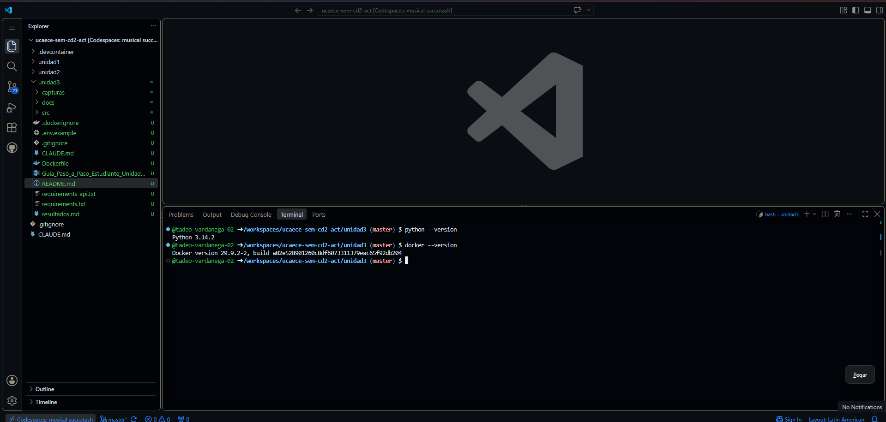
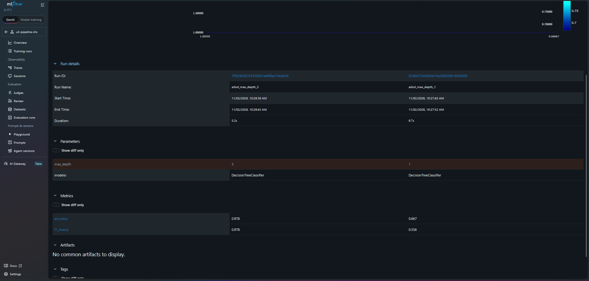
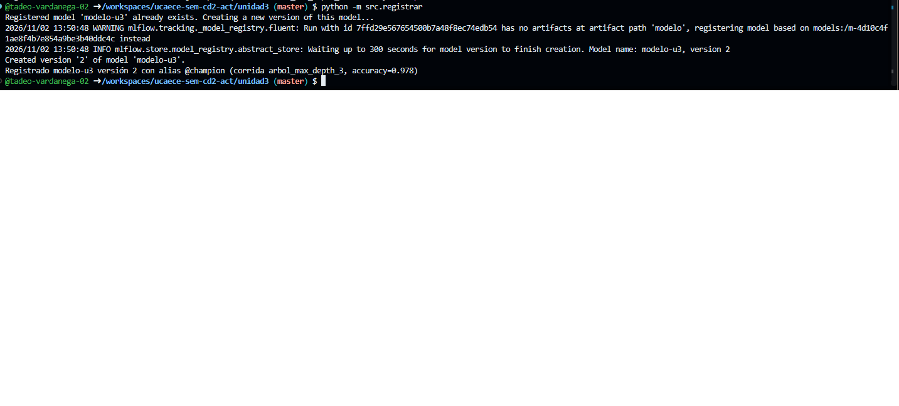
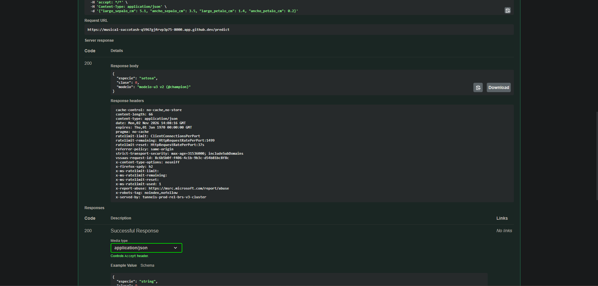

# Resultados — Unidad 3: MLOps/LLMOps

**Estudiante:** Tadeo Vardanega

**Fecha:** 02/11/2026

---

## Consigna 6: Preparación del entorno

---

## Consigna 7: Experimentación y registro con MLflow

| Corrida | max_depth | accuracy | f1_macro | Comentario |
|---|---|---|---|---|
| arbol_max_depth_1 | 1 | 0.667 | 0.556 | Árbol simple, posible underfitting |
| arbol_max_depth_3 | 3 | 0.978 | 0.978 | Mejor corrida, seleccionada como @champion |

- Modelo registrado: `modelo-u3`
- Versión: 2
- Alias: `@champion`
- Corrida origen: `arbol_max_depth_3` (accuracy=0.978)

> La corrida con max_depth=3 obtuvo accuracy=0.978 y f1_macro=0.978, muy superior a la de max_depth=1 (accuracy=0.667, f1_macro=0.556), porque un árbol más profundo captura mejores reglas de separación entre las especies del Iris. Un árbol demasiado profundo (por ejemplo max_depth=4) podría sobreajustarse y generalizar peor en datos nuevos. Conviene registrar todas las corridas, incluso las peores, porque MLflow (tracking justificado en la consigna 2) permite comparar objetivamente el efecto de cada hiperparámetro, revertir a versiones anteriores si el campeón degrada en producción y mantener trazabilidad de experimentos fallidos para no repetirlos.

---

## Consigna 8: Serving con FastAPI

| Entrada (sl, sw, pl, pw) | Especie predicha | Clase | Versión del modelo |
|---|---|---|---|
| [5.1, 3.5, 1.4, 0.2] | setosa | 0 | modelo-u3 v1 @champion |
| [7.0, 3.2, 4.7, 1.4] | versicolor | 1 | modelo-u3 v1 @champion |
| [6.3, 3.3, 6.0, 2.5] | virginica | 2 | modelo-u3 v1 @champion |
| [-1.0, 3.5, 1.4, 0.2] | Error de validación | — | — |

> Al recibir un dato inválido (por ejemplo, una medida negativa), FastAPI con Pydantic valida el cuerpo de la petición antes de que llegue al endpoint `/predict`. La petición no llega al modelo; FastAPI devuelve un error HTTP 422 (Unprocessable Entity) con el detalle del campo que no cumple el esquema (debe ser mayor que cero). Este comportamiento es importante en producción porque evita que datos corruptos o malformados lleguen al modelo, protege la integridad del sistema, evita predicciones sin sentido y permite al sistema emisor corregir el envío antes de reintentar.

---

## Consigna 9: Containerización con Docker

> Contar con ambas imágenes etiquetadas (`modelo-u3:1.0` y `modelo-u3:1.1`) permite aplicar la estrategia elegida (canary release) sin implementarla todavía: se puede dirigir una pequeña fracción del tráfico al contenedor 1.1 y el resto al 1.0 a través del balanceador de carga, monitorear métricas y errores, y si todo es estable, mover todo el tráfico a 1.1. Alternativamente, se podría hacer blue-green conmutando todo el tráfico de una imagen a la otra, o A/B testing comparando ambas durante un período con métricas de negocio. Como cada imagen lleva su propio modelo embebido, no se depende de MLflow en tiempo de inferencia.

